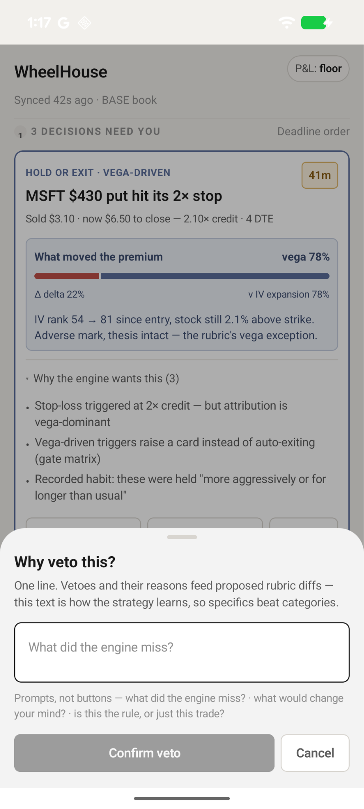
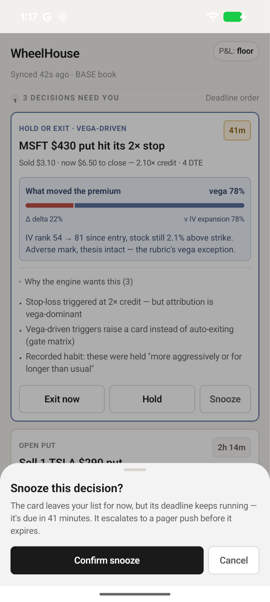

## My first experiment: Claude builds an Android app

As described in [this blog article](/blog/claude-android-app-accessibility/), I
found 8 WCAG failures after prompting Claude to build an Android app without
accessibility guidance. Then I audited one user flow for
[WCAG 2.2](https://www.w3.org/TR/WCAG22/) AA compliance.

## I gave Claude the accessibility findings

I asked Claude Code (Opus 5.5) to fix the Android app for the 8 WCAG failures. I
wanted to see how well Claude could fix these failures when given the
accessibility findings but not implementation instructions.

To ensure Claude didn’t apply my solutions in
[this PR](https://github.com/carmenvkrol/wheelhouse-android-app/pull/1), I
created a
[new GitHub repo](https://github.com/carmenvkrol/wheelhouse-android-app-claude-fixes)
that copied _only_ the
[original repo's main branch](https://github.com/carmenvkrol/wheelhouse-android-app).
I also didn’t include the original
[README](https://github.com/carmenvkrol/wheelhouse-android-app/blob/main/README.md),
as it includes details from the first experiment, including the first blog
article.

With the new repo, I told Claude the problem, but not how to fix it. For
example: _On the “Vega hold-or-exit” card, the “41m” badge is announcing on
TalkBack as “41 meters”. It should announce as “41 minutes”._

## Claude successfully remediated them (almost)

Claude functionally fixed all eight WCAG failures in
[this PR](https://github.com/carmenvkrol/wheelhouse-android-app-claude-fixes/pull/1)
without implementation instructions, with one caveat described in the next
section, “Fixing one issue required new UI”. I confirmed the fixes using
TalkBack, external keyboard, or the
[WebAIM color contrast checker](https://webaim.org/resources/contrastchecker/).

However, one implementation differed from how I would have addressed the issue.

To ensure the accessibility button role is announced on TalkBack for the “Exit
now,” “Hold,” and “Snooze” buttons,
[Claude wrapped the Text component with a Box component that uses a button role](https://github.com/carmenvkrol/wheelhouse-android-app-claude-fixes/commit/672ca2694044d630e539d5a791512dc9072f49ba).
I’d advise
[using the Button component instead](https://github.com/carmenvkrol/wheelhouse-android-app/pull/1/changes/c0265737a0a8e3ceef7c9856e706488e2bf19336)
to better ensure the buttons provide full accessibility behavior.

## Fixing one issue required new UI

One failure I asked Claude to fix was a
[WCAG 3.3.4 violation](https://www.w3.org/TR/WCAG22/#error-prevention-legal-financial-data),
which requires mechanisms such as confirmation, review, or reversibility for
certain high-consequence submissions.

Because WheelHouse is designed to test stock trades, I considered the criterion
applicable. The “Exit now” and “Snooze” actions couldn’t be reversed or
confirmed before taking effect. There also wasn’t an alternative way elsewhere
in the app to recover from making the wrong choice. (When activated, the “Hold”
button showed a bottom sheet with an option to cancel).

I told Claude that the “Exit now” and “Snooze” actions didn’t offer a way to
confirm or undo the action, and asked it to address the potential WCAG 3.3.4
violation.

Claude proposed a couple of solutions. I asked it to implement confirmation
steps similar to the existing “Hold” flow. Addressing this finding required
Claude to create new confirmation flows. That gave me an opportunity to see
whether the accessibility patterns we’d discussed earlier carried over to newly
created UI—and whether Claude would introduce other issues.

### The new UI reflected our earlier accessibility discussions

Claude created three bottom sheets, but they weren’t equally accessible.

| Bottom sheet | Built when                 | Heading role announced by TalkBack? | Pass color contrast? |
| ------------ | -------------------------- | ----------------------------------- | -------------------- |
| Hold         | Before accessibility fixes | No                                  | No                   |
| Exit         | After accessibility fixes  | Yes                                 | Yes                  |
| Snooze       | After accessibility fixes  | Yes                                 | Yes                  |

I noticed that for the new bottom sheets, Claude already addressed similar
accessibility patterns in the other issues. For example, there was a
[WCAG 1.3.1 violation](https://www.w3.org/TR/WCAG22/#info-and-relationships)
because the card heading, i.e., “MSFT $430 put hit its 2x stop”, was styled as a
heading but didn’t announce with a heading accessibility role on TalkBack.
Claude successfully fixed this in
[this commit](https://github.com/carmenvkrol/wheelhouse-android-app-claude-fixes/pull/1/changes/197aada837a48e68cb521e2eec2f5880a5e2d9c5).

However, for the “Hold” bottom sheet, titled “Why veto this?,” the heading role
wasn’t announced on TalkBack. But for the headings of the other bottom sheets,
“Exit this position now?” and “Snooze this decision?”, the heading role was
announced. These two bottom sheets were added in the same session after the
missing heading role on the main card was fixed.

Another issue was that the subtext color contrast on the “Hold” bottom sheet,
starting with “Prompts,” did not meet WCAG 1.4.3. The new bottom sheets passed
color contrast. The bottom sheets were created after I had asked Claude to fix a
color contrast issue with the “Sold $3.10 …” subtext on the main card.

**The timing was interesting**. Claude created the “Hold” bottom sheet before I
asked Claude to fix the accessibility issues, and it had both the heading-role
and color-contrast problems. Claude created the “Exit” and “Snooze” bottom
sheets after we discussed and fixed those issues, and both passed those checks.

The timing suggests that our earlier accessibility discussions may have
influenced how Claude implemented the new UI.

### But it didn’t catch everything

However, for the new bottom sheets Claude added for the “Exit now” and “Snooze”
buttons, Claude introduced another accessibility issue. The top handle is
focusable, but missing an accessibility label and role. With a focus stop that
announces nothing, a screen reader won’t know what this element does. The fix
would be to either add a label and role or hide it from screen reader users,
since they can already dismiss the bottom sheet with the “Cancel” button.

This suggests that Claude may carry accessibility patterns forward within a
coding session, but that doesn’t mean it will catch every issue in new UI.

## What did I still need to do as an accessibility engineer?

In this experiment, Claude drastically reduced the amount of implementation work
required to remediate the accessibility issues. But it didn’t eliminate the need
for accessibility expertise.

I still needed to:

- Identify the problems
- Determine the applicable WCAG criteria
- Evaluate the proposed implementation
- Verify the fixes with assistive technology
- Test the new UI for issues that hadn’t been discussed

In other words, the accessibility engineer’s role may shift from implementing
every fix to identifying problems, specifying expected behavior, evaluating the
AI-generated implementation, and independently verifying the results.

This was a small experiment with one app and one coding session. It doesn’t
establish how reliably Claude will remediate accessibility issues in other
projects, but it gives me a useful starting point for testing that question.

## My next experiment: human-written code

I was surprised by how well Claude fixed the accessibility issues without
needing implementation guidance. In my past experience, Claude and other AI
models struggled to implement correctly unless I gave them explicit guidance.
There were a couple of differences between this experience and my past
experience, which dealt with:

- Human-written, not AI-written, code
- Cross-platform frameworks like React Native

However, because AI is improving so drastically, Claude may work just as well
with human-written code and cross-platform frameworks. I’m curious to find out!
In my next experiment, I’ll test whether Claude can identify and remediate
accessibility issues in a human-written, cross-platform mobile app.

## Thanks

Thank you [Gemma Sweeney](https://www.linkedin.com/in/sweeneygk),
[Holli Smith](https://www.hollielizabeth.com/), and
[Patrick Dowell](https://github.com/patrick-dowell) for providing feedback on a
previous version of this article.
